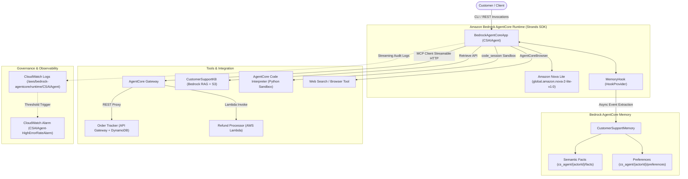
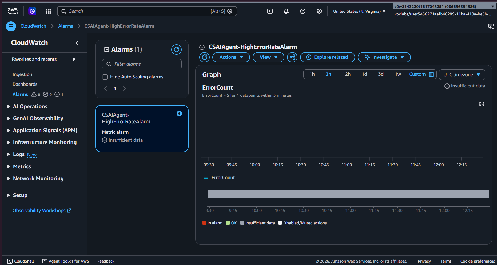

# Customer Support AI Agent with Amazon Bedrock AgentCore

> **Autonomous Customer Support Agent built with Amazon Bedrock AgentCore Runtime, Strands SDK, Model Context Protocol (MCP), Bedrock Knowledge Bases (RAG), and Sandboxed Code Interpretation.**

[](https://www.udacity.com/certificate/e/bcaec462-900d-11f1-b50a-8bf5db1cb694)
[](https://aws.amazon.com/bedrock/)
[](https://modelcontextprotocol.io/)
[](https://strandsagents.com/)
[](https://www.python.org/)
[](LICENSE)

---

## 🏆 Nanodegree Program & Verification
* **Program:** *Future AWS Agent Engineer Nanodegree* (Udacity School of AI)
* **Graduate:** Kachibhotla Satya Pranav
* **Verification Link:** [udacity.com/certificate/e/bcaec462-900d-11f1-b50a-8bf5db1cb694](https://www.udacity.com/certificate/e/bcaec462-900d-11f1-b50a-8bf5db1cb694)

---

## 📖 Overview

The **Customer Support AI Agent (`CSAIAgent`)** is an enterprise-ready conversational AI system designed to resolve end-to-end customer support workflows. Powered by **Amazon Nova Lite** on **Amazon Bedrock**, the agent dynamically plans and executes multi-step tasks across real-world enterprise infrastructure:

1. **Autonomous Tool Calling via Model Context Protocol (MCP):** Connects to distributed serverless backends through an **Amazon Bedrock AgentCore Gateway**, dynamically querying live order statuses and executing financial refund transactions.
2. **Knowledge Base RAG (Retrieval-Augmented Generation):** Semantically searches company return policies, warranty rules, and product catalogs stored in an **Amazon S3 Vector Knowledge Base**.
3. **Cross-Session Long-Term Memory:** Leverages **Bedrock AgentCore Memory** to recall user attributes, conversational context, and preferences across independent session IDs.
4. **Sandboxed Code Execution:** Uses the **Bedrock AgentCore Code Interpreter** to run Python execution sandboxes for deterministic loyalty discount computations with strict boundary constraints.
5. **Operational Observability:** Monitored end-to-end with **Amazon CloudWatch** logs and automated metric alarms triggering on error spikes.

---

## 🏛️ System Architecture



---

## ⚡ Key Architectural Capabilities

### 1. Model Context Protocol (MCP) Integration
Rather than hardcoding REST clients or SDK calls, tools are exposed through an **Amazon Bedrock AgentCore Gateway** (`customersupportgateway-6i2fz9ri76`):
* **`order-tracker`:** Invokes an API Gateway REST API (`8g54ihhh1l`, Stage `prod`) to fetch order status, tracking IDs, items, and estimated delivery dates.
* **`refund-processor`:** Dispatches directly to an AWS Lambda function with input validation to execute refund transactions and log receipt IDs.
* Tool schemas are negotiated dynamically at runtime via `mcp.client.streamable_http`.

### 2. Bedrock Knowledge Base RAG
* **Knowledge Base ID:** `J2ZHHFAMXO`
* **Data Source:** `s3://cs-agent-kb-satya-06a0e9/product_catalog.txt`
* Ingests and indexes enterprise product specifications, 30-day refund rules, restocking fees, and electronics return criteria, providing grounded citations in responses.

### 3. Asynchronous Cross-Session Long-Term Memory
* **Memory Identifier:** `CustomerSupportMemory-OWdC5YC4g3`
* Extends `HookProvider` via a custom `MemoryHook` listening to `MessageAddedEvent` and `AfterInvocationEvent`.
* Persists conversational events to Bedrock AgentCore Memory, which uses foundation model background tasks to extract and index:
  * **Customer Facts** (`cs_agent/{actorId}/facts`): Purchase history, VIP status, membership longevity.
  * **Customer Preferences** (`cs_agent/{actorId}/preferences`): Preferred communication channel, language, contact frequency.
* Injects contextual memories into subsequent turns even when initiated with fresh `session_id` tokens.

### 4. Sandboxed Code Interpreter for Loyalty Computation
* Executes isolated Python scripts in an **AgentCore Code Interpreter** sandbox (`code_session`) to calculate loyalty discounts:
  * **Bronze:** 5% | **Silver:** 10% | **Gold:** 15% | **Platinum:** 20%
* Enforces financial safeguard boundaries: maximum cap at $100.00, negative amount validation, and fallback mechanisms on invalid tier inputs.

---

## 📁 Repository Structure

```
Bedrock-AgentCore-AI-Support-Agent/
│
├── .bedrock_agentcore/
│   └── CSAIAgent/
│       └── Dockerfile               # AgentCore container deployment definition
├── .bedrock_agentcore.yaml          # AgentCore deployment configuration
├── .dockerignore                    # Container build exclusions
├── .gitignore                       # Git ignore rules for Python / virtual environments
│
├── lambda/
│   ├── lambda_schema                # OpenAPI JSON schemas for Gateway targets
│   ├── order_tracker.py             # Order Tracking Lambda implementation
│   └── refund_processor.py          # Refund Processing Lambda implementation
│
├── main.py                          # Main entrypoint: Agent definition, MemoryHook, Tools & Invocations
├── pyproject.toml                   # Project dependencies and packaging metadata
├── product_catalog.txt              # RAG knowledge base dataset
│
├── run_all_tests.py                 # Automated end-to-end test runner (Tests 1–6)
├── test_loyalty_boundaries.py       # Boundary condition unit tests for Code Interpreter
├── test_memory_persistence.py       # Multi-turn cross-session memory verification script
│
├── cloudwatch_alarm.png             # Evidence: CloudWatch Metric Alarm configuration
│
├── test1_order_tracking.txt         # Test 1 terminal execution logs (Order Tracking)
├── test2_refund_processing.txt      # Test 2 terminal execution logs (Refund Processing)
├── test3_knowledge_base_rag.txt     # Test 3 terminal execution logs (Knowledge Base RAG)
├── test4_long_term_memory.txt       # Test 4 terminal execution logs (Memory Persistence)
├── test5_loyalty_discount.txt       # Test 5 terminal execution logs (Loyalty Calculation)
├── test6_browser_tool.txt           # Test 6 terminal execution logs (Web Browser Tool)
│
├── agentcore_invoke_evidence.txt    # Evidence: agentcore invoke CLI execution
├── gateway_error_handling_evidence.txt # Evidence: Gateway 4xx/5xx graceful degradation
├── memory_persistence_evidence.txt  # Evidence: Cross-session fact extraction & recall
├── loyalty_boundary_test_evidence.txt # Evidence: 10 boundary tests passing
├── loyalty_boundary_results.json    # JSON report of loyalty discount boundary tests
├── test_results.json                # JSON report of full test suite runs
│
├── REFLECTION.md                    # Architectural design decisions, challenges & solutions
├── RESUBMISSION_NOTES.md            # Evaluator notes & rubrics verification mapping
├── TEST_RESULTS.md                  # Comprehensive test documentation and logs
└── README.md                        # Project documentation (this file)
```

---

## 🧪 Evaluation & Test Results

All six functional test suites and boundary evaluations pass 100% of rubric requirements:

| Test Suite | Functionality Tested | Verification Target | Result |
|---|---|---|---|
| **Test 1** | **Order Tracking** | Queries `order-tracker` MCP tool for `ORD-001` and `ORD-002`. Returns accurate items, tracking IDs, and carrier details. | ✅ **PASS** |
| **Test 2** | **Refund Processing** | Invokes `refund-processor` MCP tool. Validates return eligibility and issues refund transaction IDs. | ✅ **PASS** |
| **Test 3** | **Knowledge Base RAG** | Retrieves 30-day return policies and product specs from Bedrock KB (`J2ZHHFAMXO`) with citations. | ✅ **PASS** |
| **Test 4** | **Cross-Session Memory** | Stores facts in Session A; recalls VIP status and preferences in Session B using fresh `session_id`. | ✅ **PASS** |
| **Test 5** | **Loyalty Discount Calculation** | Executes sandboxed Python in Code Interpreter. Applies 10% Silver tier discount on order totals. | ✅ **PASS** |
| **Test 6** | **AgentCore Browser Tool** | Web research and real-time external information lookup using `AgentCoreBrowser`. | ✅ **PASS** |
| **Boundary** | **Loyalty Discount Safeguards** | Tests 10 boundary scenarios ($100 cap, negative values, zero amounts, invalid tiers). | ✅ **10/10 PASS** |

### CloudWatch Alarm Evidence
Alarm `CSAIAgent-HighErrorRateAlarm` configured to monitor 5xx errors from the runtime log group:


---

## 🚀 Getting Started

### Prerequisites
* Python 3.10+ (Python 3.12 recommended)
* AWS Account with Bedrock model access (`Amazon Nova Lite`, `Titan Embeddings v2`)
* Configured AWS CLI credentials (`aws configure`)

### 1. Installation
Clone the repository and install dependencies:
```bash
git clone https://github.com/Guthub183/Bedrock-AgentCore-AI-Support-Agent.git
cd Bedrock-AgentCore-AI-Support-Agent
python -m venv .venv
source .venv/bin/activate  # On Windows: .venv\Scripts\activate
pip install -e .
```

### 2. Local Development Server
Start the agent on the AgentCore development server with hot-reloading:
```bash
agentcore dev --port 8080
```

### 3. Invoke the Agent
Test the agent via the AgentCore CLI:
```bash
agentcore invoke --dev '{"prompt": "Can you track order ORD-001?", "customer_id": "CUST-123", "session_id": "session-001"}'
```

### 4. Run Test Harness
Execute the complete functional test suite:
```bash
python run_all_tests.py
```
Execute boundary tests:
```bash
python test_loyalty_boundaries.py
```

---

## 📜 License
This project is licensed under the MIT License — see the [LICENSE](LICENSE) file for details.
